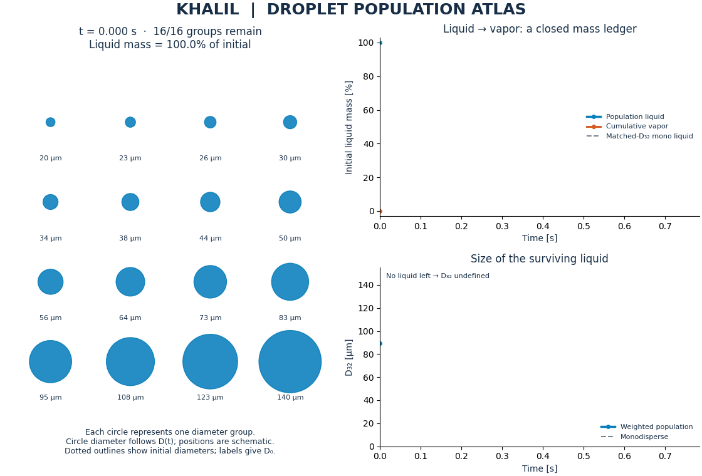
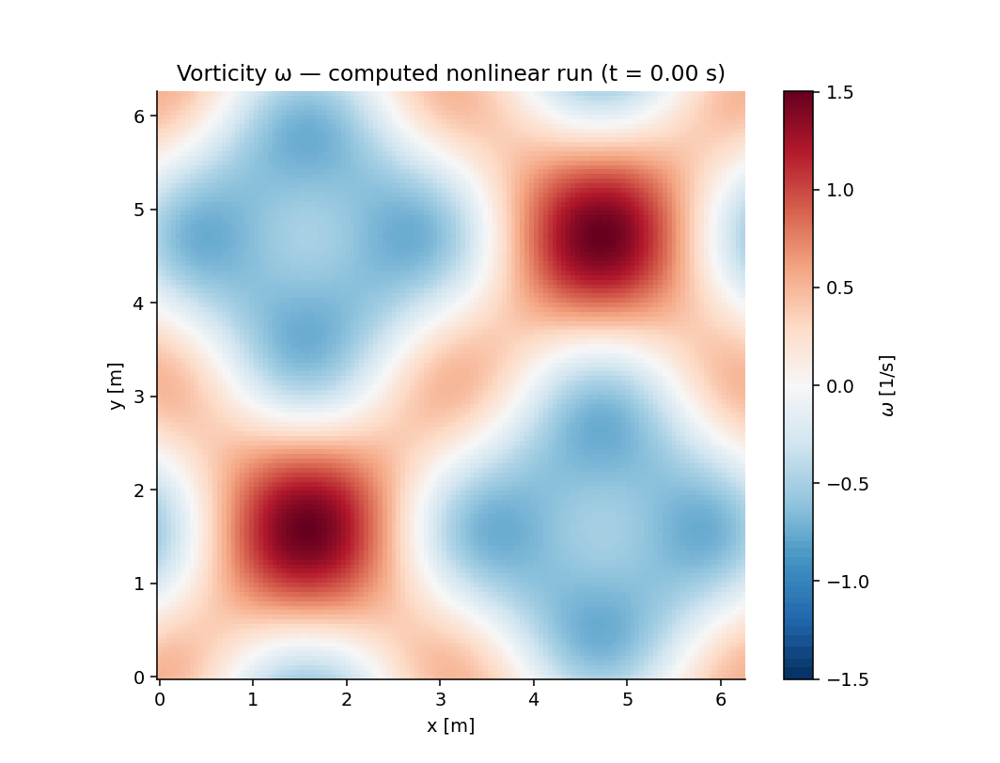
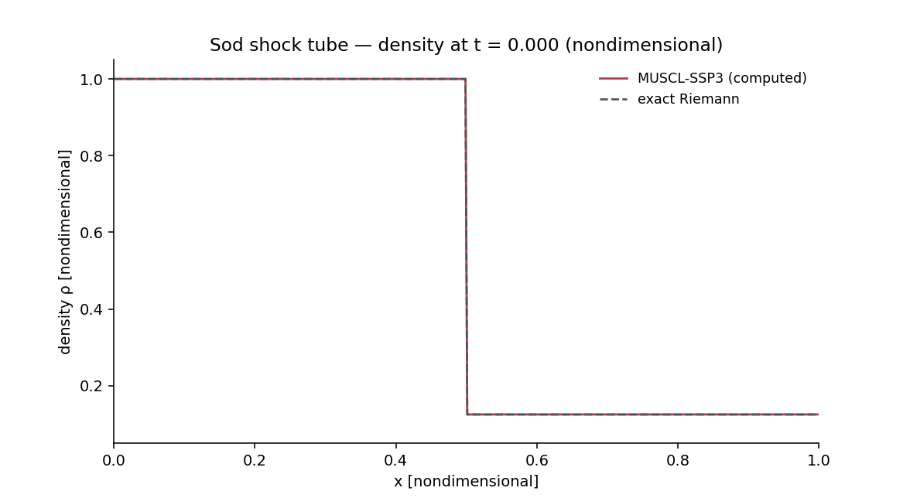

# ▶ Animated engineering results

Open a GIF link in your browser if your app shows a still preview. Each animation below comes from computed results.

## 💠 Khalil Population Atlas

An original weighted-droplet addition in Droplet Journey: 16 initial size groups, a liquid/vapor mass ledger, and a matched-mass/D32 comparison. Glyph positions are schematic. Constant-K analytic model; no spray-CFD or experimental claim.

[**Open the 61-frame animation**](https://github.com/khalil-official/khalil-official/raw/refs/heads/main/media/khalil_population_atlas.gif)

[Source, equations, tests and saved data](https://github.com/khalil-official/droplet-journey/blob/main/docs/population_atlas.md)

## 🔬 Published, reviewed results

### Vortex Notebook

[**Open animation · 41 frames**](https://github.com/khalil-official/khalil-official/raw/refs/heads/main/media/vorticity_evolution.gif) · [Project](https://github.com/khalil-official/vortex-notebook)

### Shockline

[**Open animation · 41 frames**](https://github.com/khalil-official/khalil-official/raw/refs/heads/main/media/sod_evolution.gif) · [Project](https://github.com/khalil-official/shockline-euler)

### Droplet Journey

[**Open animation · 41 frames**](https://github.com/khalil-official/khalil-official/raw/refs/heads/main/media/droplet_journey.gif) · [Project](https://github.com/khalil-official/droplet-journey)

## 🛠️ Results still in review

These preview GIFs are on review branches rather than the default project pages. Their numerical/documentation review is ongoing. Links are pinned to the inspected commit; a visible preview does not mean the project has passed final review.

- [Channel Lattice — open 60-frame preview](https://raw.githubusercontent.com/khalil-official/channel-lattice/8edbad48666445ea53b840614b8ac3b702840b50/docs/results/profile_development.gif) · [review](https://github.com/khalil-official/channel-lattice/pull/1)
- [Ignition Zero — open 41-frame preview](https://raw.githubusercontent.com/khalil-official/ignition-zero/ea2441f7ae986a41d7e6d82053270da640da24c6/docs/results/ignition_evolution.gif) · [review](https://github.com/khalil-official/ignition-zero/pull/1)
- [Droplet PINN Studio — open 40-frame preview](https://raw.githubusercontent.com/khalil-official/droplet-pinn-studio/7966f8ce7f26a08fe8f0d9597427119af75102de/docs/results/training_evolution.gif) · [review](https://github.com/khalil-official/droplet-pinn-studio/pull/1)
- [Truss Equilibrium — open 41-frame preview](https://raw.githubusercontent.com/khalil-official/truss-equilibrium/b2f98c311382fb41a1e843788f2fc35c07e70815/docs/results/load_progression.gif) · [review](https://github.com/khalil-official/truss-equilibrium/pull/1)
- [Trajectory Fusion C — open 60-frame preview](https://raw.githubusercontent.com/khalil-official/trajectory-fusion-c/8518ac5f2bbcd3632bd317e42154a49080f24222/docs/results/covariance_ellipses.gif) · [review](https://github.com/khalil-official/trajectory-fusion-c/pull/1)
- [Bracket Root Fortran — open 46-frame preview](https://raw.githubusercontent.com/khalil-official/bracket-root-fortran/fe6bc2e3fde253f64261fe6a6059264cb6fcbaf9/docs/results/bracket_animation.gif) · [review](https://github.com/khalil-official/bracket-root-fortran/pull/1)
- [Modal Current — open 60-frame preview](https://raw.githubusercontent.com/khalil-official/modal-current/f45e369fe51e45fc385fbab3e9ee42a0490e84a7/docs/results/modal_current_demo.gif) · [review](https://github.com/khalil-official/modal-current/pull/1)
- [Thermal Streams — open 48-frame preview](https://raw.githubusercontent.com/khalil-official/thermal-streams/a9945a1/docs/results/counterflow_profiles_ntu.gif) · [source snapshot](https://github.com/khalil-official/thermal-streams/tree/a9945a1)
