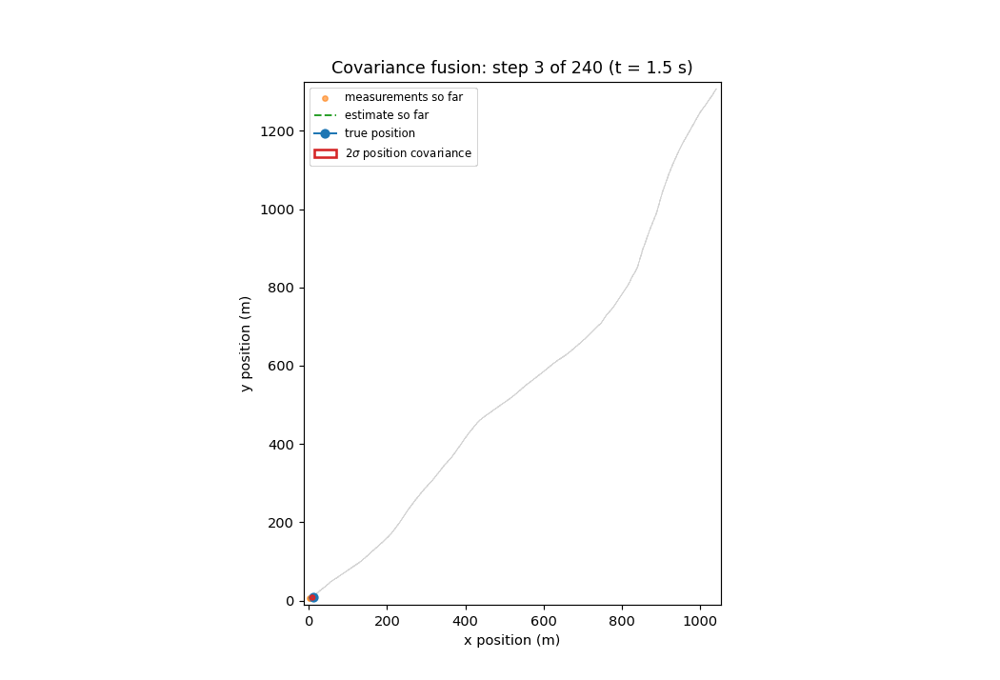
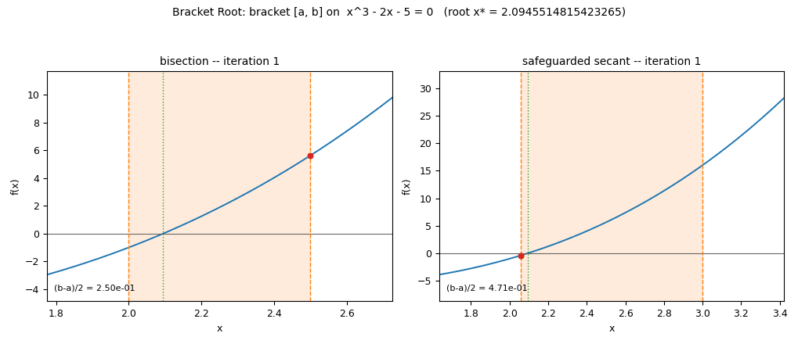
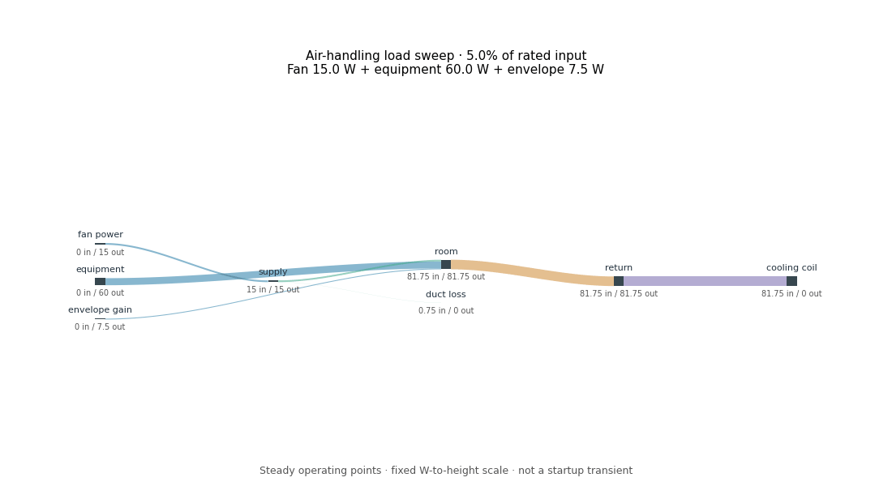
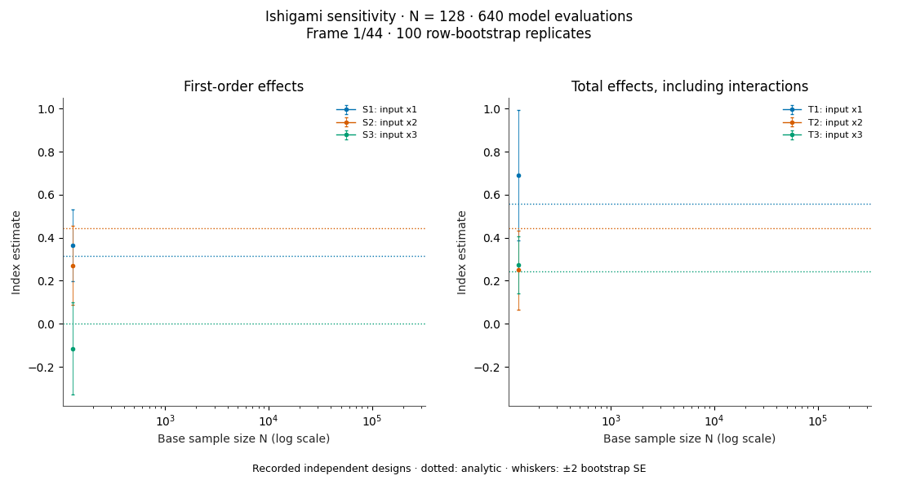
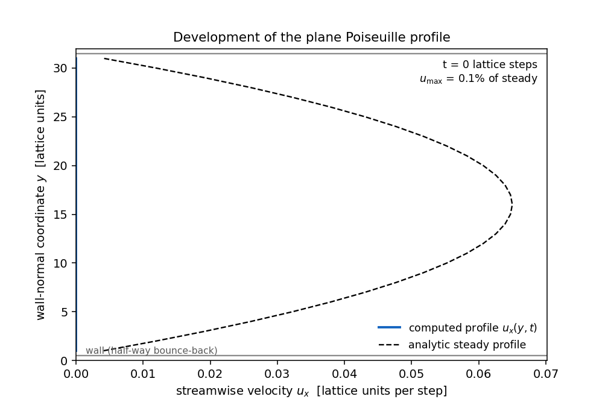
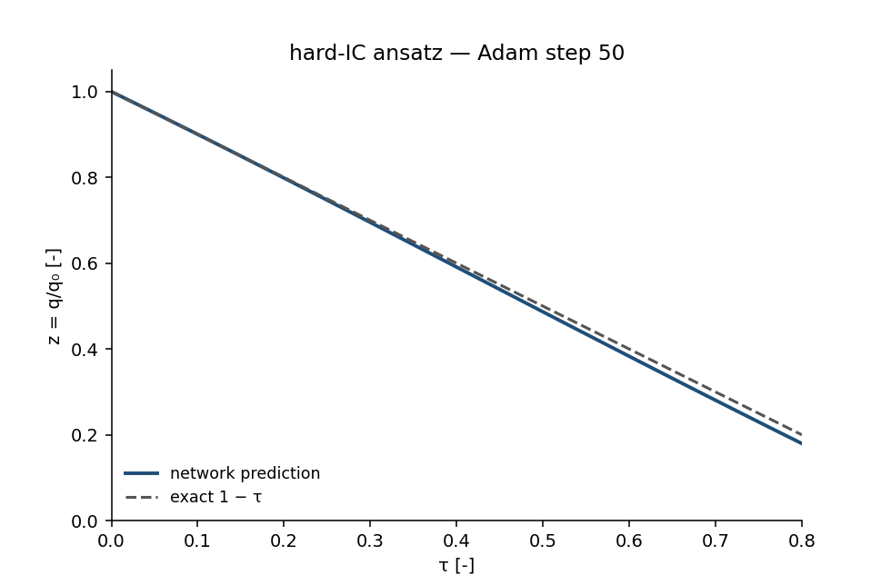

# ▶ Animated engineering results

Open a GIF link in your browser if your app shows a still preview. Each animation below comes from computed results.

## 💠 Khalil Population Atlas

An original weighted-droplet addition in Droplet Journey: 16 initial size groups, a liquid/vapor mass ledger, and a matched-mass/D32 comparison. Glyph positions are schematic. Constant-K analytic model; no spray-CFD or experimental claim.

[**Open the 61-frame animation**](https://github.com/khalil-official/khalil-official/raw/refs/heads/main/media/khalil_population_atlas.gif)

[Source, equations, tests and saved data](https://github.com/khalil-official/droplet-journey/blob/main/docs/population_atlas.md)

## 🔬 Published, reviewed results

### Vortex Notebook

[**Open animation · 41 frames**](https://github.com/khalil-official/khalil-official/raw/refs/heads/main/media/vorticity_evolution.gif) · [Project](https://github.com/khalil-official/vortex-notebook)

### Shockline

[**Open animation · 41 frames**](https://github.com/khalil-official/khalil-official/raw/refs/heads/main/media/sod_evolution.gif) · [Project](https://github.com/khalil-official/shockline-euler)

### Droplet Journey

[**Open animation · 41 frames**](https://github.com/khalil-official/khalil-official/raw/refs/heads/main/media/droplet_journey.gif) · [Project](https://github.com/khalil-official/droplet-journey)

### Trajectory Fusion

Native C99 estimation on a documented synthetic trajectory; position error and two-standard-deviation covariance ellipses.

[**Open animation · 60 frames**](https://github.com/khalil-official/khalil-official/raw/refs/heads/main/media/covariance_ellipses.gif) · [Project](https://github.com/khalil-official/trajectory-fusion-c)

### Bracket Root

Actual Fortran bracket histories for the cubic reference case; bisection and safeguarded secant, regenerated after the midpoint-stop repair.

[**Open animation · 46 frames**](https://github.com/khalil-official/khalil-official/raw/refs/heads/main/media/bracket_animation.gif) · [Project](https://github.com/khalil-official/bracket-root-fortran)

### Energy Flow Atlas

Balanced power ledger and quantitative Sankey geometry; 23 tests, seven transfers, fixed scale and saved frame data.

[**Open animation · 41 frames**](https://github.com/khalil-official/khalil-official/raw/refs/heads/main/media/energy_flow_load_sweep.gif) · [Project and reproduction](https://github.com/khalil-official/energy-flow-atlas)

### Thermal Streams

Heat-exchanger rating and conditioned temperature fields; 770 parametrized cases, 80-digit reference, both capacity orientations.

[**Open animation · 48 frames**](https://github.com/khalil-official/khalil-official/raw/refs/heads/main/media/thermal_counterflow_profiles.gif) · [Project and reproduction](https://github.com/khalil-official/thermal-streams)

### Pipeflow Bench

Pipe friction and pressure loss with residual-based stopping; 39 tests, actual solver traces and explicit transition flags.

[**Open animation · 43 frames**](https://github.com/khalil-official/khalil-official/raw/refs/heads/main/media/pipeflow_bisection.gif) · [Project and reproduction](https://github.com/khalil-official/pipeflow-bench)

### Variance Compass

Centered covariance sensitivity with row bootstrap; 88 tests, affine-invariance regression and analytic Ishigami comparisons.

[**Open animation · 44 frames**](https://github.com/khalil-official/khalil-official/raw/refs/heads/main/media/variance_compass_convergence.gif) · [Project and reproduction](https://github.com/khalil-official/variance-compass)

### Channel Lattice

D2Q9 channel flow with exact wall placement and Guo forcing. 68 tests; independent Poiseuille benchmark; relative L2 error 2.09e-4.

[**Open animation · 62 frames**](https://github.com/khalil-official/khalil-official/raw/refs/heads/main/media/channel_profile_development.gif) · [Project and reproduction](https://github.com/khalil-official/channel-lattice)

### Droplet PINN Studio

Equal-budget hard/soft initial-condition PINNs for the normalized droplet ODE. 6 CPU tests; reproduced seed-0 profile; held-out maximum absolute error 7.72e-5.

[**Open animation · 40 frames**](https://github.com/khalil-official/khalil-official/raw/refs/heads/main/media/pinn_optimizer_progress.gif) · [Project and reproduction](https://github.com/khalil-official/droplet-pinn-studio)

## 🛠️ Results still in review

These preview GIFs are on review branches rather than the default project pages. Their numerical/documentation review is ongoing. Links are pinned to the inspected commit; a visible preview does not mean the project has passed final review.

- [Ignition Zero — open 41-frame preview](https://raw.githubusercontent.com/khalil-official/ignition-zero/ea2441f7ae986a41d7e6d82053270da640da24c6/docs/results/ignition_evolution.gif) · [review](https://github.com/khalil-official/ignition-zero/pull/1)
- [Truss Equilibrium — open 41-frame preview](https://raw.githubusercontent.com/khalil-official/truss-equilibrium/b2f98c311382fb41a1e843788f2fc35c07e70815/docs/results/load_progression.gif) · [review](https://github.com/khalil-official/truss-equilibrium/pull/1)
- [Modal Current — open 60-frame preview](https://raw.githubusercontent.com/khalil-official/modal-current/f45e369fe51e45fc385fbab3e9ee42a0490e84a7/docs/results/modal_current_demo.gif) · [review](https://github.com/khalil-official/modal-current/pull/1)
