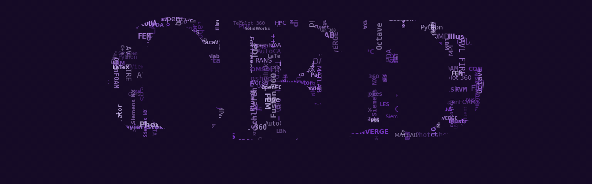
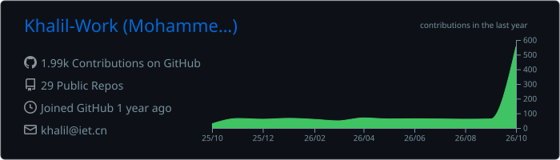

    

---

### 🧭 About me

PhD candidate in mechanical engineering with a love for **aviation** — I build
open-source CFD solvers and scientific machine learning studies, all verified
against exact references in my
[verified catalogue](https://github.com/khalil-work/verified-scientific-computing).

---

### 🌟 Featured work — live simulations, click to open

---

### 🧱 More verified solvers — click any card

| | | | |
| --- | --- | --- | --- |
|  |  |  |  |
|  |  |  |  |
|  |  |  |  |
|  |  |  |  |

---

### 🌊 CFD solvers & meshing

### 📐 CAD & geometry

### 📊 Post-processing & visualization

### 💻 Coding & scripting

<code></code>
<code></code>
<code></code>
<code></code>

<code></code>
<code></code>

### 🔬 Experimental diagnostics

### 🎨 Design & media

---

### 💭 Quote of the day

---

### 📊 GitHub activity

---

### 💬 Ask me anything

Questions about CFD, verification, PINNs or any project?
Open a thread in the [Discussions](https://github.com/khalil-work/khalil-work/discussions) of this profile —
happy to talk solvers, benchmarks, aviation and mountains.

