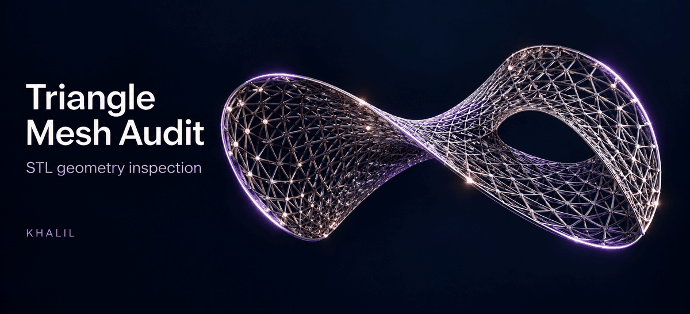
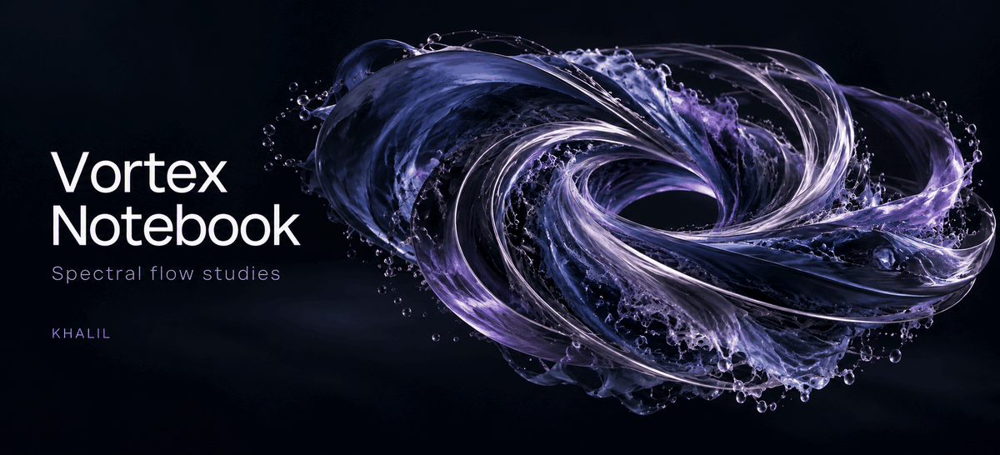
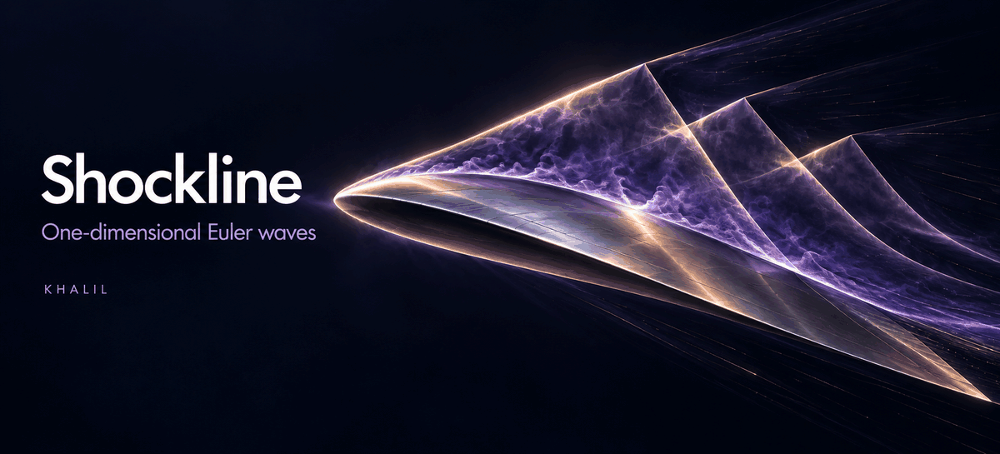
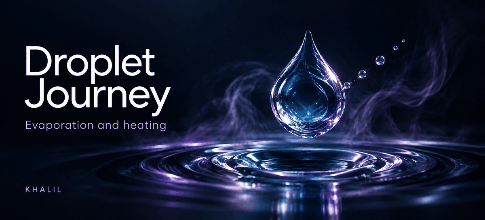

PhD student in mechanical engineering, exploring **CFD**, **numerical methods**, and **scientific machine learning**. I build computational studies with documented methods and verification.

🌐 <a href="https://khalil-work.github.io/">Portfolio website</a> &nbsp; · &nbsp; 📚 <a href="https://github.com/Khalil-Work/verified-scientific-computing">Verified catalogue</a> &nbsp; · &nbsp; 💬 <a href="https://github.com/Khalil-Work/khalil-work/discussions">Discussions</a>

---

## ✨ Selected work

<table width="100%">
<tr>
<td width="50%" valign="top" align="center"> <strong><a href="https://github.com/Khalil-Work/triangle-mesh-audit">Triangle Mesh Audit ↗</a></strong> STL geometry audit</td>
<td width="50%" valign="top" align="center"> <strong><a href="https://github.com/Khalil-Work/vortex-notebook">Vortex Notebook ↗</a></strong> Spectral flow studies</td>
</tr>
<tr>
<td width="50%" valign="top" align="center"> <strong><a href="https://github.com/Khalil-Work/shockline-euler">Shockline ↗</a></strong> Euler wave benchmarks</td>
<td width="50%" valign="top" align="center"> <strong><a href="https://github.com/Khalil-Work/droplet-journey">Droplet Journey ↗</a></strong> Evaporation &amp; heating</td>
</tr>
</table>

Illustrated covers — click to open the code, methods and results. · <a href="docs/PROFILE_DESIGN.md">Still covers</a>

---

## 📚 Project library

### Flow, combustion & heat transfer

[Channel Lattice](https://github.com/Khalil-Work/channel-lattice) · [Pipeflow Bench](https://github.com/Khalil-Work/pipeflow-bench) · [Ignition Zero](https://github.com/Khalil-Work/ignition-zero) · [Thermal Streams](https://github.com/Khalil-Work/thermal-streams) · [Thermal Pathways](https://github.com/Khalil-Work/thermal-pathways) · [Heatwave · GNU Octave](https://github.com/Khalil-Work/heatwave-octave)

### Learning, inference & reduced models

[Droplet PINN Studio](https://github.com/Khalil-Work/droplet-pinn-studio) · [Modal Current · POD/DMD](https://github.com/Khalil-Work/modal-current) · [Cooling Curve Inverse](https://github.com/Khalil-Work/cooling-curve-inverse) · [Variance Compass](https://github.com/Khalil-Work/variance-compass)

### Numerical methods & engineering

[Bracket Root · Fortran](https://github.com/Khalil-Work/bracket-root-fortran) · [Quadrature Workbench](https://github.com/Khalil-Work/quadrature-workbench) · [Parallel Numerics Bench](https://github.com/Khalil-Work/parallel-numerics-bench) · [Trajectory Fusion · C](https://github.com/Khalil-Work/trajectory-fusion-c) · [Truss Equilibrium](https://github.com/Khalil-Work/truss-equilibrium) · [Energy Flow Atlas](https://github.com/Khalil-Work/energy-flow-atlas)

---

## 🛠️ Research toolkit

### 🌊 CFD & meshing

 &nbsp;  &nbsp;  &nbsp;  &nbsp;  &nbsp;  &nbsp;  &nbsp;  &nbsp;  &nbsp; 

### 💻 Scientific programming

 &nbsp;  &nbsp;  &nbsp;  &nbsp;  &nbsp;  &nbsp;  &nbsp; 

### 📐 CAD & geometry

 &nbsp;  &nbsp;  &nbsp; 

### 📊 Post-processing & visualization

 &nbsp;  &nbsp;  &nbsp;  &nbsp; 

### 🧰 Verification & reproducibility

 &nbsp;  &nbsp;  &nbsp;  &nbsp; 

### 🔬 Experimental diagnostics

🔎 PIV &nbsp; · &nbsp; 💠 PDA/PDPA &nbsp; · &nbsp; 🔬 PDI &nbsp; · &nbsp; 🌡️ Hot-wire CTA &nbsp; · &nbsp; 💡 Schlieren imaging

### 🎨 Visual communication

 &nbsp; 

---

## 💭 Daily inspiration & curiosity

A little perspective, a little curiosity — beyond research.

<table width="100%">
<tr>
<td width="50%" valign="top" align="center">
<h3>💭 Quote of the day</h3>
<picture><source media="(prefers-color-scheme: dark)" srcset="https://raw.githubusercontent.com/Khalil-Work/khalil-work/output/daily/quote-dark.svg"></picture>

<a href="https://zenquotes.io/">Inspirational quotes provided by ZenQuotes API</a>

</td>
<td width="50%" valign="top" align="center">
<h3>🧩 Trivia of the day</h3>
<picture><source media="(prefers-color-scheme: dark)" srcset="https://raw.githubusercontent.com/Khalil-Work/khalil-work/output/daily/trivia-dark.svg"></picture>
</td>
</tr>
</table>

<a href="https://github.com/Khalil-Work/khalil-work/blob/output/daily/README.md">Read today’s quote and trivia as text ↗</a>

🕰️ When I push — recent public activity in UTC+8

<picture><source media="(prefers-color-scheme: dark)" srcset="https://raw.githubusercontent.com/Khalil-Work/khalil-work/output/daily/timing-dark.svg"></picture>

This panel samples recent public **push events**, rather than commit counts or working hours. [Sample and refresh details](https://github.com/Khalil-Work/khalil-work/blob/output/daily/README.md#recent-public-push-timing).

---

## 🐍 A playful contribution trail

<picture><source media="(prefers-color-scheme: dark)" srcset="https://raw.githubusercontent.com/Khalil-Work/khalil-work/output/github-contribution-grid-snake-dark.svg"></picture>

---

## ⛰️ Beyond research

Beyond research, I’m drawn to mountain trails and aviation.

🔗 <a href="https://www.linkedin.com/in/mohammed-khalil1/">LinkedIn</a> &nbsp; · &nbsp; ▶️ <a href="https://www.youtube.com/@MohammedKHALIIL">YouTube</a> &nbsp; · &nbsp; 🌐 <a href="https://khalil-work.github.io/">Portfolio website</a>

<a href="#top">⬆️ Back to top</a>

